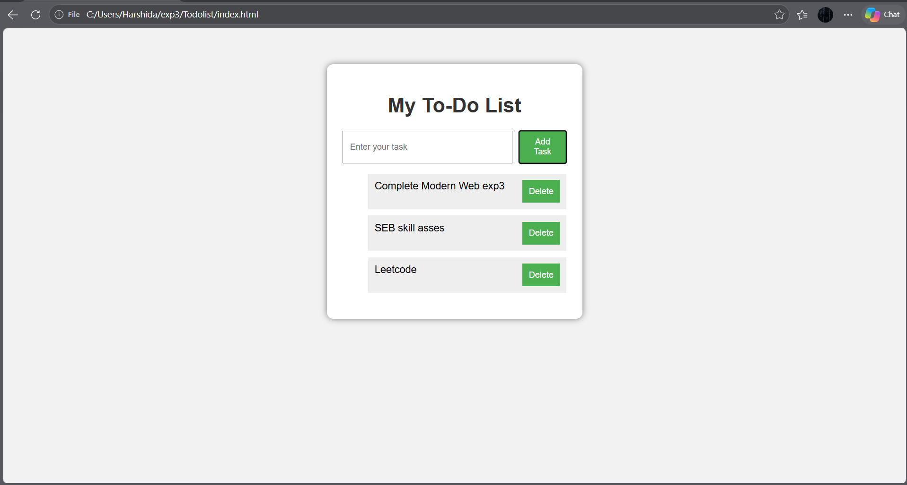

# Ex03 To-Do List using JavaScript
## Date: 17.11.2026

## AIM
To create a To-do Application with all features using JavaScript.

## ALGORITHM
### STEP 1
Build the HTML structure (index.html).

### STEP 2
Style the App (style.css).

### STEP 3
Plan the features the To-Do App should have.

### STEP 4
Create a To-do application using Javascript.

### STEP 5
Add functionalities.

### STEP 6
Test the App.

### STEP 7
Open the HTML file in a browser to check layout and functionality.

### STEP 8
Fix styling issues and refine content placement.

### STEP 9
Deploy the website.

### STEP 10
Upload to GitHub Pages for free hosting.

## PROGRAM

index.html
```
<!DOCTYPE html>
<html>
<head>
    <title>To-Do Application</title>
    <link rel="stylesheet" href="style.css">
</head>
<body>

    <div class="container">
        <h1>My To-Do List</h1>

        <div class="input-section">
            <input type="text" id="taskInput" placeholder="Enter your task">
            <button onclick="addTask()">Add Task</button>
        </div>

        <ul id="taskList"></ul>
    </div>

    <script src="script.js"></script>
</body>
</html>
```
style.css
```
body {
    font-family: Arial, sans-serif;
    background-color: #f2f2f2;
    display: flex;
    justify-content: center;
    padding-top: 50px;
}

.container {
    background: white;
    padding: 25px;
    width: 350px;
    border-radius: 10px;
    box-shadow: 0 0 10px gray;
}

h1 {
    text-align: center;
    color: #333;
}

.input-section {
    display: flex;
    gap: 10px;
}

input {
    padding: 10px;
    width: 70%;
}

button {
    padding: 10px;
    background-color: #4CAF50;
    color: white;
    border: none;
    cursor: pointer;
}

li {
    padding: 10px;
    margin-top: 10px;
    background: #eee;
    display: flex;
    justify-content: space-between;
}

.completed {
    text-decoration: line-through;
    color: gray;
}
```
script.js
```
function addTask() {
    let input = document.getElementById("taskInput");
    let task = input.value.trim();

    if (task === "") {
        alert("Please enter a task!");
        return;
    }

    let li = document.createElement("li");
    li.textContent = task;

    li.onclick = function () {
        li.classList.toggle("completed");
    };

    let deleteBtn = document.createElement("button");
    deleteBtn.textContent = "Delete";

    deleteBtn.onclick = function (event) {
        event.stopPropagation();
        li.remove();
    };

    li.appendChild(deleteBtn);
    document.getElementById("taskList").appendChild(li);

    input.value = "";
}
```
## OUTPUT



## RESULT
The program for creating To-do list using JavaScript is executed successfully.

